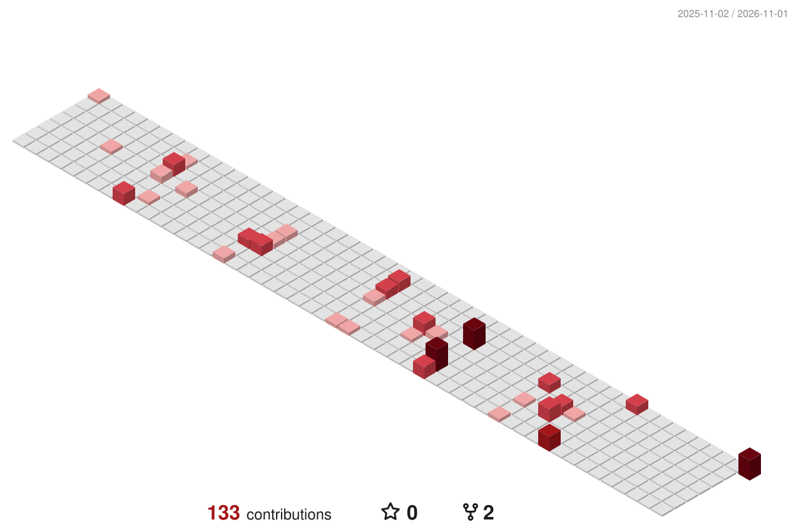

  

 

 

  

  

<samp>&nbsp;&nbsp;&nbsp;&nbsp;&nbsp;&nbsp;&nbsp;&nbsp;.-&quot;&quot;-.&nbsp;&nbsp;&nbsp;&nbsp;&nbsp;&nbsp;&nbsp;&nbsp;NAME&nbsp;&nbsp;...&nbsp;&nbsp;Anubhav&nbsp;Bayard&nbsp;&nbsp;&nbsp;&nbsp;&nbsp;&nbsp;&nbsp;&nbsp;&nbsp;&nbsp;&nbsp;&nbsp;&nbsp;&nbsp;&nbsp;&nbsp;&nbsp;&nbsp;&nbsp;&nbsp;&nbsp;&nbsp;&nbsp;&nbsp;&nbsp;&nbsp;&nbsp;&nbsp;&nbsp;&nbsp; 
&nbsp;&nbsp;&nbsp;&nbsp;&nbsp;&nbsp;&nbsp;/&nbsp;.--.&nbsp;\&nbsp;&nbsp;&nbsp;&nbsp;&nbsp;&nbsp;&nbsp;TITLE&nbsp;...&nbsp;&nbsp;Software&nbsp;Developer&nbsp;·&nbsp;Open&nbsp;Source&nbsp;Raider&nbsp;&nbsp;&nbsp;&nbsp;&nbsp; 
&nbsp;&nbsp;&nbsp;&nbsp;&nbsp;&nbsp;/&nbsp;/&nbsp;&nbsp;&nbsp;&nbsp;\&nbsp;\&nbsp;&nbsp;&nbsp;&nbsp;&nbsp;&nbsp;HALL&nbsp;&nbsp;...&nbsp;&nbsp;The&nbsp;Terminal&nbsp;&nbsp;&nbsp;&nbsp;&nbsp;&nbsp;&nbsp;&nbsp;&nbsp;&nbsp;&nbsp;&nbsp;&nbsp;&nbsp;&nbsp;&nbsp;&nbsp;&nbsp;&nbsp;&nbsp;&nbsp;&nbsp;&nbsp;&nbsp;&nbsp;&nbsp;&nbsp;&nbsp;&nbsp;&nbsp;&nbsp;&nbsp; 
&nbsp;&nbsp;&nbsp;&nbsp;&nbsp;&nbsp;|&nbsp;|&nbsp;&nbsp;&nbsp;&nbsp;|&nbsp;|&nbsp;&nbsp;&nbsp;&nbsp;&nbsp;&nbsp;OATH&nbsp;&nbsp;...&nbsp;&nbsp;Do&nbsp;the&nbsp;work.&nbsp;Do&nbsp;it&nbsp;well.&nbsp;Never&nbsp;stop&nbsp;growing. 
&nbsp;&nbsp;&nbsp;&nbsp;&nbsp;&nbsp;|&nbsp;|.-&quot;&quot;-.|&nbsp;&nbsp;&nbsp;&nbsp;&nbsp;&nbsp;RUNE&nbsp;&nbsp;...&nbsp;&nbsp;ᚨ&nbsp;&nbsp;ansuz&nbsp;—&nbsp;the&nbsp;word,&nbsp;the&nbsp;craft,&nbsp;the&nbsp;signal&nbsp;&nbsp; 
&nbsp;&nbsp;&nbsp;&nbsp;&nbsp;///`.::::.`\&nbsp;&nbsp;&nbsp;&nbsp;&nbsp;FACT&nbsp;&nbsp;...&nbsp;&nbsp;An&nbsp;outstanding&nbsp;introvert&nbsp;&nbsp;&nbsp;&nbsp;&nbsp;&nbsp;&nbsp;&nbsp;&nbsp;&nbsp;&nbsp;&nbsp;&nbsp;&nbsp;&nbsp;&nbsp;&nbsp;&nbsp;&nbsp;&nbsp; 
&nbsp;&nbsp;&nbsp;&nbsp;|||&nbsp;::/&nbsp;&nbsp;\::&nbsp;;&nbsp;&nbsp;&nbsp;&nbsp;&nbsp;&nbsp;&nbsp;&nbsp;&nbsp;&nbsp;&nbsp;&nbsp;&nbsp;&nbsp;&nbsp;&nbsp;&nbsp;&nbsp;&nbsp;&nbsp;&nbsp;&nbsp;&nbsp;&nbsp;&nbsp;&nbsp;&nbsp;&nbsp;&nbsp;&nbsp;&nbsp;&nbsp;&nbsp;&nbsp;&nbsp;&nbsp;&nbsp;&nbsp;&nbsp;&nbsp;&nbsp;&nbsp;&nbsp;&nbsp;&nbsp;&nbsp;&nbsp;&nbsp;&nbsp;&nbsp;&nbsp;&nbsp;&nbsp;&nbsp;&nbsp;&nbsp;&nbsp;&nbsp;&nbsp; 
&nbsp;&nbsp;&nbsp;&nbsp;||;&nbsp;::\__/::&nbsp;;&nbsp;&nbsp;&nbsp;&nbsp;Studying&nbsp;system&nbsp;design&nbsp;fundamentals,&nbsp;so&nbsp;every&nbsp;&nbsp;&nbsp;&nbsp;&nbsp;&nbsp;&nbsp;&nbsp;&nbsp;&nbsp; 
&nbsp;&nbsp;&nbsp;&nbsp;&nbsp;\\\&nbsp;&#x27;::::&#x27;&nbsp;/&nbsp;&nbsp;&nbsp;&nbsp;&nbsp;trade-off&nbsp;at&nbsp;scale&nbsp;is&nbsp;a&nbsp;choice,&nbsp;never&nbsp;an&nbsp;accident.&nbsp;&nbsp;&nbsp;&nbsp;&nbsp; 
&nbsp;&nbsp;&nbsp;&nbsp;&nbsp;&nbsp;`=&#x27;:-..-&#x27;`&nbsp;&nbsp;&nbsp;&nbsp;&nbsp;&nbsp;&nbsp;&nbsp;&nbsp;&nbsp;&nbsp;&nbsp;&nbsp;&nbsp;&nbsp;&nbsp;&nbsp;&nbsp;&nbsp;&nbsp;&nbsp;&nbsp;&nbsp;&nbsp;&nbsp;&nbsp;&nbsp;&nbsp;&nbsp;&nbsp;&nbsp;&nbsp;&nbsp;&nbsp;&nbsp;&nbsp;&nbsp;&nbsp;&nbsp;&nbsp;&nbsp;&nbsp;&nbsp;&nbsp;&nbsp;&nbsp;&nbsp;&nbsp;&nbsp;&nbsp;&nbsp;&nbsp;&nbsp;&nbsp;&nbsp;&nbsp;&nbsp;&nbsp;&nbsp;&nbsp;&nbsp;</samp>

<samp>ᚱ&nbsp;&nbsp;&nbsp;SAILING&nbsp;TOWARD&nbsp;&nbsp;...&nbsp;&nbsp;scalable&nbsp;web&nbsp;systems,&nbsp;clean&nbsp;architecture&nbsp;&nbsp;&nbsp; 
ᚲ&nbsp;&nbsp;&nbsp;FORGING&nbsp;&nbsp;&nbsp;&nbsp;&nbsp;&nbsp;&nbsp;&nbsp;&nbsp;...&nbsp;&nbsp;Web&nbsp;Development,&nbsp;backend&nbsp;craft,&nbsp;honest&nbsp;APIs 
ᛗ&nbsp;&nbsp;&nbsp;SEEKING&nbsp;CREW&nbsp;&nbsp;&nbsp;&nbsp;...&nbsp;&nbsp;open&nbsp;source,&nbsp;ambitious&nbsp;web&nbsp;builds&nbsp;&nbsp;&nbsp;&nbsp;&nbsp;&nbsp;&nbsp;&nbsp;&nbsp;&nbsp; 
ᛊ&nbsp;&nbsp;&nbsp;ASK&nbsp;ME&nbsp;OF&nbsp;&nbsp;&nbsp;&nbsp;&nbsp;&nbsp;&nbsp;...&nbsp;&nbsp;my&nbsp;life&nbsp;:)&nbsp;&nbsp;&nbsp;&nbsp;&nbsp;&nbsp;&nbsp;&nbsp;&nbsp;&nbsp;&nbsp;&nbsp;&nbsp;&nbsp;&nbsp;&nbsp;&nbsp;&nbsp;&nbsp;&nbsp;&nbsp;&nbsp;&nbsp;&nbsp;&nbsp;&nbsp;&nbsp;&nbsp;&nbsp;&nbsp;&nbsp;&nbsp;&nbsp; 
ᚹ&nbsp;&nbsp;&nbsp;SEND&nbsp;WORD&nbsp;&nbsp;&nbsp;&nbsp;&nbsp;&nbsp;&nbsp;...&nbsp;&nbsp;letsmailanu.10@gmail.com&nbsp;&nbsp;&nbsp;&nbsp;&nbsp;&nbsp;&nbsp;&nbsp;&nbsp;&nbsp;&nbsp;&nbsp;&nbsp;&nbsp;&nbsp;&nbsp;&nbsp;&nbsp;&nbsp;</samp>

  

  

<samp>&nbsp;&nbsp;&nbsp;\\&nbsp;&nbsp;&nbsp;&nbsp;&nbsp;&nbsp;&nbsp;&nbsp;&nbsp;&nbsp;&nbsp;&nbsp;&nbsp;&nbsp;&nbsp;&nbsp;&nbsp;&nbsp;&nbsp;&nbsp;&nbsp;&nbsp;&nbsp;&nbsp;&nbsp;&nbsp;&nbsp;&nbsp;&nbsp;&nbsp;&nbsp;&nbsp;&nbsp;&nbsp;&nbsp;&nbsp;&nbsp;&nbsp;&nbsp;&nbsp;&nbsp;&nbsp;//&nbsp;&nbsp;&nbsp; 
&nbsp;&nbsp;&nbsp;&nbsp;\\________________&nbsp;&nbsp;_________________________//&nbsp; 
&nbsp;&nbsp;&nbsp;&nbsp;&nbsp;[___MJOLNIR______][____SEAX_________________&gt;&nbsp;&nbsp; 
&nbsp;&nbsp;&nbsp;&nbsp;//&nbsp;&nbsp;&nbsp;&nbsp;&nbsp;&nbsp;&nbsp;&nbsp;&nbsp;&nbsp;&nbsp;&nbsp;&nbsp;&nbsp;&nbsp;&nbsp;&nbsp;&nbsp;&nbsp;&nbsp;&nbsp;&nbsp;&nbsp;&nbsp;&nbsp;&nbsp;&nbsp;&nbsp;&nbsp;&nbsp;&nbsp;&nbsp;&nbsp;&nbsp;&nbsp;&nbsp;&nbsp;&nbsp;&nbsp;&nbsp;&nbsp;&nbsp;\\&nbsp;&nbsp; 
&nbsp;&nbsp;&nbsp;//&nbsp;&nbsp;&nbsp;&nbsp;&nbsp;weapons&nbsp;carried&nbsp;into&nbsp;every&nbsp;raid&nbsp;&nbsp;&nbsp;&nbsp;&nbsp;&nbsp;&nbsp;&nbsp;&nbsp;\\</samp>

  

  

<samp>tales&nbsp;worth&nbsp;telling&nbsp;at&nbsp;the&nbsp;fire&nbsp;—&nbsp;the&nbsp;latest&nbsp;voyages</samp>

  

  

<samp>every&nbsp;raid&nbsp;a&nbsp;rune&nbsp;carved&nbsp;in&nbsp;stone&nbsp;—&nbsp;one&nbsp;year&nbsp;of&nbsp;plunder,&nbsp;in&nbsp;three&nbsp;dimensions</samp>

carved anew every three hours by GitHub Actions · <a href="https://github.com/yoshi389111/github-profile-3d-contrib">github-profile-3d-contrib</a>

  

  

<samp>the&nbsp;world&nbsp;serpent&nbsp;wakes,&nbsp;and&nbsp;devours&nbsp;the&nbsp;runes&nbsp;of&nbsp;the&nbsp;year</samp>

<picture>
  <source media="(prefers-color-scheme: dark)" srcset="https://raw.githubusercontent.com/AnubhavBayard/AnubhavBayard/output/serpent-dark.svg" />
  <source media="(prefers-color-scheme: light)" srcset="https://raw.githubusercontent.com/AnubhavBayard/AnubhavBayard/output/serpent.svg" />
  
</picture>

  

  

<samp>&quot;Cattle&nbsp;die,&nbsp;kinsmen&nbsp;die,&nbsp;&nbsp;&nbsp;&nbsp;&nbsp;&nbsp;&nbsp;&nbsp;&nbsp;&nbsp;&nbsp;&nbsp;&nbsp;&nbsp;&nbsp;&nbsp;&nbsp;&nbsp;&nbsp;&nbsp;&nbsp;&nbsp;&nbsp;&nbsp;&nbsp;&nbsp;&nbsp;&nbsp; 
&nbsp;and&nbsp;so&nbsp;must&nbsp;one&nbsp;die&nbsp;oneself.&nbsp;&nbsp;&nbsp;&nbsp;&nbsp;&nbsp;&nbsp;&nbsp;&nbsp;&nbsp;&nbsp;&nbsp;&nbsp;&nbsp;&nbsp;&nbsp;&nbsp;&nbsp;&nbsp;&nbsp;&nbsp;&nbsp;&nbsp;&nbsp; 
&nbsp;But&nbsp;one&nbsp;thing&nbsp;I&nbsp;know&nbsp;that&nbsp;never&nbsp;dies:&nbsp;&nbsp;&nbsp;&nbsp;&nbsp;&nbsp;&nbsp;&nbsp;&nbsp;&nbsp;&nbsp;&nbsp;&nbsp;&nbsp;&nbsp; 
&nbsp;the&nbsp;reputation&nbsp;of&nbsp;the&nbsp;one&nbsp;who&nbsp;has&nbsp;passed.&quot;&nbsp;&nbsp;&nbsp;&nbsp;&nbsp;&nbsp;&nbsp;&nbsp;&nbsp;&nbsp; 
&nbsp;&nbsp;&nbsp;&nbsp;&nbsp;&nbsp;&nbsp;&nbsp;&nbsp;&nbsp;&nbsp;&nbsp;&nbsp;&nbsp;&nbsp;&nbsp;&nbsp;&nbsp;&nbsp;&nbsp;&nbsp;&nbsp;&nbsp;&nbsp;&nbsp;&nbsp;&nbsp;&nbsp;&nbsp;&nbsp;&nbsp;&nbsp;&nbsp;&nbsp;&nbsp;&nbsp;&nbsp;&nbsp;&nbsp;&nbsp;&nbsp;&nbsp;&nbsp;&nbsp;&nbsp;&nbsp;&nbsp;&nbsp;&nbsp;&nbsp;&nbsp;&nbsp;&nbsp; 
&nbsp;&nbsp;&nbsp;&nbsp;&nbsp;&nbsp;&nbsp;&nbsp;&nbsp;&nbsp;&nbsp;&nbsp;&nbsp;&nbsp;&nbsp;&nbsp;&nbsp;&nbsp;&nbsp;&nbsp;&nbsp;&nbsp;&nbsp;&nbsp;&nbsp;&nbsp;&nbsp;&nbsp;&nbsp;&nbsp;—&nbsp;Hávamál,&nbsp;st.&nbsp;77&nbsp;&nbsp;&nbsp;&nbsp;&nbsp;&nbsp; 
&nbsp;&nbsp;&nbsp;&nbsp;&nbsp;&nbsp;&nbsp;&nbsp;&nbsp;&nbsp;&nbsp;&nbsp;&nbsp;&nbsp;&nbsp;&nbsp;&nbsp;&nbsp;&nbsp;&nbsp;&nbsp;&nbsp;&nbsp;&nbsp;&nbsp;&nbsp;&nbsp;&nbsp;&nbsp;&nbsp;&nbsp;&nbsp;&nbsp;&nbsp;&nbsp;&nbsp;&nbsp;&nbsp;&nbsp;&nbsp;&nbsp;&nbsp;&nbsp;&nbsp;&nbsp;&nbsp;&nbsp;&nbsp;&nbsp;&nbsp;&nbsp;&nbsp;&nbsp; 
ship&nbsp;code&nbsp;that&nbsp;outlives&nbsp;the&nbsp;branch&nbsp;it&nbsp;was&nbsp;written&nbsp;on.</samp>

  

  

